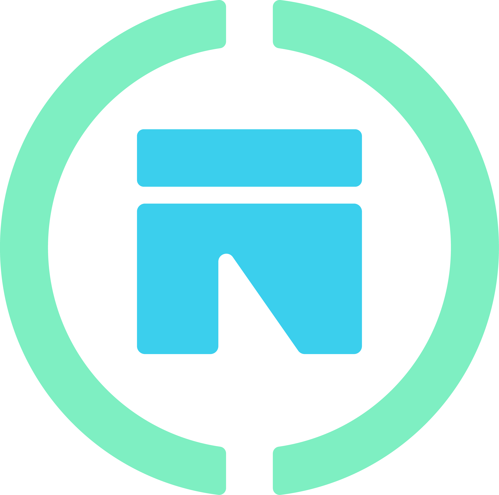

<div align="center">



# Ournego

**Descubre y apoya los negocios de tu comunidad.**
Un mapa vivo de los negocios locales, hecho por y para la gente de tu ciudad.

[](https://github.com/Yahel0506/Ournego/releases/latest/download/ournego-beta.apk)
[](https://ournego.com)


[Descargar](#-descarga-la-app) ·
[Qué puedes hacer](#-qué-puedes-hacer) ·
[Guía de uso](#-guía-de-uso) ·
[Instalación para desarrollo](#-instalación-para-desarrollo) ·
[Arquitectura](#-arquitectura) ·
[Contacto](#-contacto)

</div>

---

## 🌱 ¿Qué es Ournego?

Los mejores negocios de una ciudad no siempre están en Google ni en redes sociales: la fonda de la esquina, la panadería de la colonia, el taller de toda la vida. **Ournego** los pone en un mapa para que cualquiera los encuentre, y le da a cada negocio una ficha propia, gratis, con su ubicación, su categoría, su contacto y su foto.

- 🧭 **Para quien busca:** abre la app, mira qué hay cerca y descubre lugares que no sabías que existían.
- 🏪 **Para quien tiene un negocio:** regístralo en minutos y deja de depender de que te encuentren por casualidad.
- 🤝 **Para la comunidad:** cada dato corregido y cada negocio nuevo mejora el mapa de todos.

> El piloto arrancó en **Ciudad Guzmán, Jalisco**, y crece de la mano de las personas que lo usan: cada negocio y cada usuario nuevo ayuda a que llegue a más lugares.

## 📲 Descarga la app

### Android (APK)

1. Descarga el APK más reciente: **[ournego-beta.apk](https://github.com/Yahel0506/Ournego/releases/latest/download/ournego-beta.apk)**.
2. Ábrelo desde la carpeta de descargas de tu teléfono.
3. Si Android lo pide, permite **"Instalar apps desconocidas"** para tu navegador o gestor de archivos.
4. Abre Ournego y listo.

> Cada cambio aprobado en el proyecto publica automáticamente un APK nuevo que **reemplaza al anterior**, así que el enlace de arriba siempre apunta a la última versión.
> Si tenías instalada una compilación anterior firmada con otra clave, desinstálala primero.

### Web

Disponible desde el navegador en [ournego.com](https://ournego.com).

### iOS

Hay un flujo de compilación para iOS en el repositorio, pero todavía no se distribuye de forma pública.

## ✨ Qué puedes hacer

### 🧭 Si buscas negocios

- **Explora un mapa** con los negocios de tu zona, en modo claro u oscuro.
- **Ubícate** con tu GPS o elige una zona a mano si prefieres explorar otra parte de la ciudad.
- **Abre la ficha** de cualquier negocio: nombre, categoría, dirección, foto y contacto.
- **Llama o comparte** un negocio directamente desde su ficha.
- **Guarda tus favoritos** para volver a ellos rápido.
- **Busca por voz o por texto** y encuentra direcciones con sugerencias automáticas.

### 🏪 Si tienes un negocio

- **Regístralo** con nombre, categoría, dirección (con autocompletado), teléfono y una foto.
- **Administra tu negocio** desde tu panel dentro de la app.

### 💬 Para todos

- **Envía feedback sin salir de la app:** sacude el teléfono, escribe tu comentario y adjunta una captura.
- **Inicia sesión** con correo y contraseña o con tu cuenta de Google.
- Una **bienvenida guiada** te explica la app la primera vez que la abres.
- La pestaña de **Comunidad** está en construcción y es donde llegarán las funciones sociales.

## 🧑‍🏫 Guía de uso

### Primeros pasos

1. **Abre la app** y recorre la bienvenida. Elige cómo quieres usar Ournego (explorar o registrar un negocio) y concede el permiso de ubicación para ver lo que tienes cerca.
2. **Explora el mapa** sin necesidad de cuenta. Toca cualquier marcador para ver la ficha del negocio.
3. **Crea tu cuenta** cuando quieras guardar favoritos o registrar un negocio: con correo o con Google. La primera vez te pedirá completar tu perfil.

### Registrar tu negocio

1. Entra a la pestaña **Negocio** y toca **Registrar negocio**.
2. Completa el formulario: nombre, categoría, dirección y teléfono.
3. Sube una foto que muestre tu negocio.
4. Envía el registro. Tu negocio aparecerá en el mapa y podrás gestionarlo desde tu panel.

### Enviar comentarios sobre la app

Sacude el teléfono en cualquier pantalla, escribe qué viste o qué te gustaría que mejorara y envía. Los comentarios llegan directo al equipo.

### Problemas frecuentes

| Problema | Qué hacer |
| --- | --- |
| No veo negocios cerca | Revisa que la ubicación esté activa y con permiso, o elige una zona manualmente. |
| No se instala el APK | Permite instalar apps desconocidas, o desinstala la versión anterior si la firma cambió. |
| No me deja registrar un negocio | Necesitas iniciar sesión y completar tu perfil primero. |
| El mapa sale en blanco | Comprueba tu conexión a internet. |

## 🛠️ Instalación para desarrollo

### Requisitos

- [Flutter](https://docs.flutter.dev/get-started/install) **3.41.4** (Dart `^3.10`)
- Android Studio o VS Code con los plugins de Flutter y Dart
- Un proyecto de [Supabase](https://supabase.com) y las claves de los servicios de mapas (abajo)
- Para Android: JDK 17 y el SDK de Android. Para iOS: macOS con Xcode.

### 1. Clona e instala dependencias

```bash
git clone https://github.com/Yahel0506/Ournego.git
cd Ournego
flutter pub get
```

### 2. Configura las variables de entorno

| Variable | Para qué sirve |
| --- | --- |
| `SUPABASE_URL` | URL de tu proyecto de Supabase |
| `SUPABASE_ANON_KEY` | Clave pública (anon) de Supabase |
| `MAPBOX_ACCESS_TOKEN` | Token de Mapbox para los mosaicos del mapa |
| `MAPBOX_USERNAME` | Usuario de Mapbox dueño de los estilos |
| `MAPBOX_STYLE_ID_DARK` | Estilo de mapa para modo oscuro |
| `MAPBOX_STYLE_ID_LIGHT` | Estilo de mapa para modo claro |
| `LOCATIONIQ_API_KEY` | Clave de LocationIQ para búsqueda de direcciones |

**Android, iOS y escritorio:** crea un archivo `.env` en la raíz (ya está en `.gitignore`, no lo subas nunca):

```env
SUPABASE_URL=https://tu-proyecto.supabase.co
SUPABASE_ANON_KEY=tu_clave_anon
MAPBOX_ACCESS_TOKEN=pk.xxxxx
MAPBOX_USERNAME=tu_usuario
MAPBOX_STYLE_ID_DARK=xxxxx
MAPBOX_STYLE_ID_LIGHT=xxxxx
LOCATIONIQ_API_KEY=xxxxx
```

**Web:** copia `web/config.example.js` a `web/config.js` y rellena los valores.

### 3. Ejecuta la app

```bash
# Móvil o escritorio (lee el .env como variables de compilación)
flutter run --dart-define-from-file=.env

# Web
flutter run -d chrome
```

> Las configuraciones de VS Code en `.vscode/launch.json` ya incluyen la bandera `--dart-define-from-file`.

### 4. Compila

```bash
flutter build web                                          # Web
flutter build apk --release --dart-define-from-file=.env   # APK de Android
flutter build appbundle --dart-define-from-file=.env       # Android App Bundle
```

### 5. Calidad y pruebas

```bash
flutter analyze        # Análisis estático
dart format .          # Formato
flutter test           # Pruebas unitarias y de arquitectura
```

Las pruebas de integración usan [Patrol](https://patrol.leancode.co) y necesitan un dispositivo o emulador. La guía completa está en [`docs/development/testing/README.md`](docs/development/testing/README.md).

## 🏗️ Arquitectura

Ournego sigue **Clean Architecture organizada por funcionalidades**:

```text
lib/
├── core/        # Tema, colores, estilos, fallos, entorno y enrutamiento
├── features/    # auth · business · community · feedback · map · navigation · onboarding
│   └── <feature>/{data, domain, presentation}
└── shared/      # Widgets compartidos
```

El flujo de dependencias es `Presentation → Domain ← Data`.

| Capa | Tecnología |
| --- | --- |
| Framework | Flutter / Dart |
| Estado | `flutter_riverpod` |
| Navegación | `go_router` |
| Backend | Supabase (autenticación, base de datos y almacenamiento) |
| Mapas | `flutter_map` + Mapbox, `geolocator`, `latlong2` |
| Direcciones | LocationIQ y `mapbox_search` |
| Errores | `dartz` (`Either`) |
| Almacenamiento local | `shared_preferences`, `sembast` |
| Pruebas | `flutter_test`, `mocktail`, `patrol` |

### Despliegue continuo

- **Android:** cada cambio en `main` compila un APK firmado y lo publica como la release `latest`, reemplazando la anterior (`.github/workflows/android-release.yml`).
- **Web:** se despliega automáticamente en Firebase Hosting.
- **Calidad:** el análisis, las pruebas y la compilación de Android corren en cada pull request.

## 📚 Documentación

| Documento | Contenido |
| --- | --- |
| [`AGENTS.md`](AGENTS.md) | Convenciones de código y flujo de trabajo |
| [`docs/development/architecture/ARCHITECTURE.md`](docs/development/architecture/ARCHITECTURE.md) | Arquitectura y reglas de dependencias |
| [`docs/development/architecture/CONTEXT-MAP.md`](docs/development/architecture/CONTEXT-MAP.md) | Mapa del dominio |
| [`docs/development/design/DESIGN_SYSTEM.md`](docs/development/design/DESIGN_SYSTEM.md) | Sistema de diseño |
| [`docs/development/testing/README.md`](docs/development/testing/README.md) | Guía de pruebas |
| [`docs/development/features/`](docs/development/features) | Una ficha por funcionalidad |
| [`docs/project/scope/first-release-scope.md`](docs/project/scope/first-release-scope.md) | Alcance del primer lanzamiento |

## 🗺️ Hoja de ruta

- [x] Mapa de negocios con ubicación y zona manual
- [x] Registro de negocios con foto, categoría y contacto
- [x] Favoritos y feedback dentro de la app
- [ ] Revisión y aprobación de negocios, y reporte de datos incorrectos
- [x] Distribución de APK de Android
- [ ] Comunidad: funciones sociales entre usuarios y negocios
- [ ] Versionado de la app y publicación en tiendas
- [ ] Más ciudades

## 🤝 Participa

¿Tienes un negocio, quieres probar la app o tienes una idea? Descárgala, úsala y cuéntanos qué piensas con la función de feedback de la app o escribiéndonos.

El código se publica para que puedas **leerlo y aprender de él** con fines no comerciales. Para contribuir con cambios, colaborar o hablar de otra licencia, escríbenos antes.

## 📄 Licencia

Ournego es software de **código disponible** bajo la licencia [PolyForm Strict 1.0.0](LICENSE.md): puedes leerlo y usarlo con fines no comerciales, pero no copiarlo, distribuirlo, modificarlo ni usarlo comercialmente sin permiso por escrito. El nombre, el logo, la mascota y la identidad visual de Ournego no están licenciados para ningún otro uso. Las dependencias de terceros conservan sus propias licencias.

## 📬 Contacto

- 🌐 [ournego.com](https://ournego.com)
- ✉️ [contacto@ournego.com](mailto:contacto@ournego.com)

<div align="center">

Hecho con 💚 por **Angel Yahel López Zepeda** · © 2026 Ournego

</div>
