# OUR-140 — Validación en Android real: arranque, sesión, red, ubicación y Google

Fecha: 15 de octubre de 2026.
Issue: OUR-140 (padre: OUR-110). Punto de partida de OUR-102 (flujos críticos en Android real, S5).

## Dispositivo y build

| Dato | Valor |
| --- | --- |
| Dispositivo | Samsung Galaxy S24 (SM-S921B), físico, conectado por USB y controlado con ADB |
| Android | 16 (API 36) |
| Conectividad | Wi-Fi y datos móviles |
| App | `com.ournego.app`, build **debug** de la rama `yahel0506/our-110-debug-simulation-startup` (PR #106) |
| Configuración | `--dart-define-from-file=.env`; el escenario 1 real usa una build sin defines |
| Tema | Oscuro |

Los escenarios 1, 3, 4, 5 y las pruebas de Google se ejecutaron con la build del commit `1e5648e`. El commit `04aba0f` solo corrige la interfaz del simulador (ver hallazgos) y se comprobó en el mismo dispositivo.

## Método

Siempre que fue posible se reprodujo la **condición real** en el dispositivo y, además, la del simulador de debug (`docs/development/plans/our-110-debug-simulation.md`):

- **Red:** `svc wifi disable` y `svc data disable` (hacen falta ambos: con solo el Wi-Fi apagado el teléfono cae a datos móviles y sigue en línea).
- **Permiso de ubicación:** `pm revoke` / `pm grant` de `ACCESS_FINE_LOCATION` y `ACCESS_COARSE_LOCATION`.
- **GPS:** `settings put secure location_mode 0`.
- **Configuración:** build sin `--dart-define`, sin `.env` empaquetado.
- **Sesión y fallos de Google:** presets y secciones del Debug Panel; el selector de cuentas de Google y el login con éxito se hicieron con la cuenta real del usuario.

La evidencia son capturas del propio dispositivo en `docs/development/testing/evidence/our-140/` (comprimidas a 540×1170).

## Matriz de resultados

| # | Escenario | Resultado |
| --- | --- | --- |
| 1 | Fallo de configuración / Supabase | ✅ Cumple |
| 2 | Sesión vencida | ✅ Cumple |
| 3 | Sin red al abrir | ✅ Cumple |
| 4 | Red perdida durante el uso | ✅ Cumple (con una observación) |
| 5 | Sin ubicación (OUR-133) | ✅ Cumple |
| 6 | Login con Google (OUR-129) | ✅ Cumple |

### 1. Fallo de configuración / Supabase

- **Esperado:** estado y acción claros, sin entrar en un flujo roto. `Ournego no puede iniciar`, con `Ver ayuda` y sin `Reintentar`.
- **Real (build sin defines):** pantalla `Ournego no puede iniciar` / `Esta instalación necesita una corrección para funcionar.` con `Ver ayuda`; sin `Reintentar`, sin franja de simulación (confirma que un fallo real no se marca como simulado). 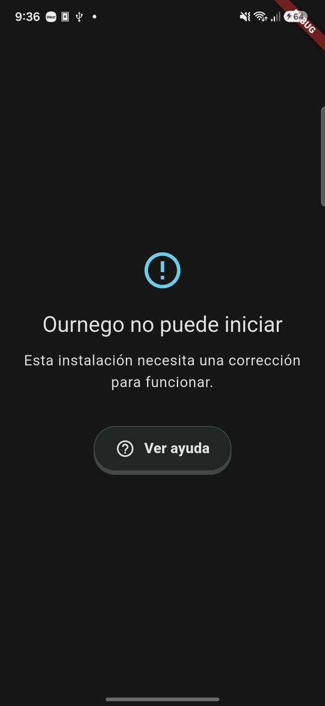
- **Simulado (preset 1):** misma pantalla con la franja "Fallo simulado (debug)". `Ver ayuda` abre el diálogo local y `Desactivar y reiniciar` devuelve a la app. 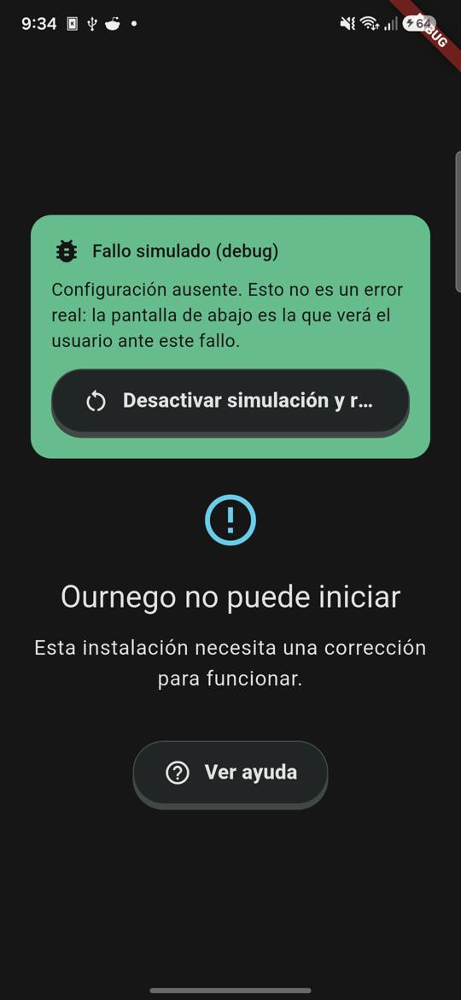
- **Resultado:** cumple.

### 2. Sesión vencida

- **Esperado:** diálogo `Tu sesión venció`; `Iniciar sesión` vuelve a la ruta previa tras entrar; `Seguir como invitado` deja la app usable.
- **Obtenido:**
  1. Login real con Google (cuenta del usuario, elegida en el selector del sistema): mapa con avatar. 
  2. "Vencer sesión ahora" (refresh con un token desconocido; el SDK emite el `signedOut` real): aparece `Tu sesión venció` sobre la pantalla actual. 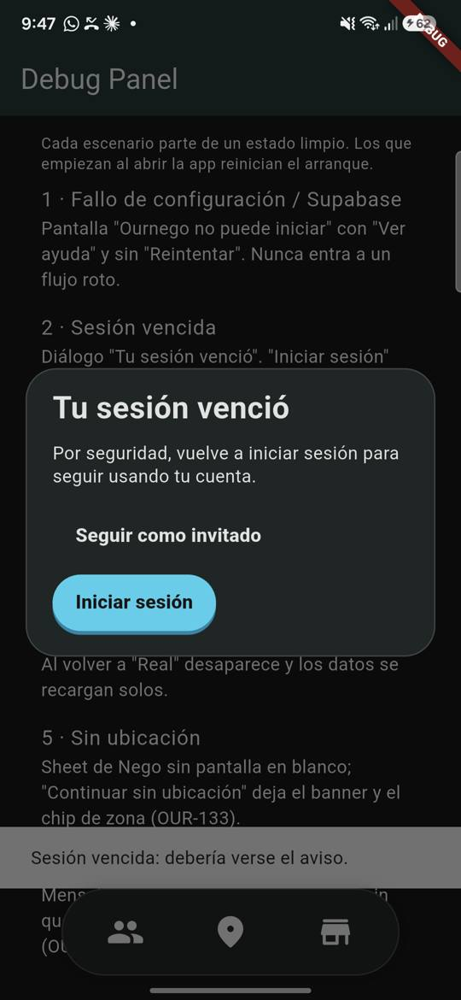
  3. `Iniciar sesión` → Google → vuelve al **Debug Panel** (la ruta previa) con `Sesión: activa`. 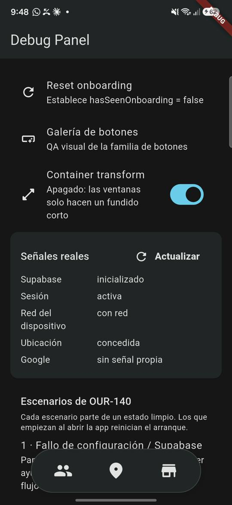
  4. Segunda expiración → `Seguir como invitado`: el mapa funciona y el menú de perfil muestra `Invitado`. 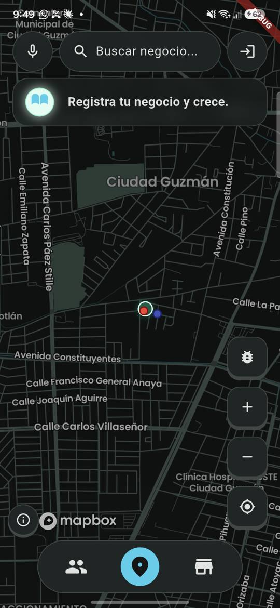
- **Límite:** la expiración se provoca revocando el refresh token desde la app; no se revocó la sesión desde el panel de Supabase.
- **Resultado:** cumple.

### 3. Sin red al abrir

- **Esperado:** el mapa se ve con el banner `Sin conexión`, sin cargas infinitas; al volver la red, `Conexión restablecida`.
- **Obtenido (Wi-Fi y datos apagados, app cerrada y abierta):** mapa con el banner `Sin conexión. Algunas funciones no estarán disponibles.` a los 5 y a los 15 s, sin indicadores de carga. Al reactivar la red el banner desaparece y los negocios vuelven a aparecer. 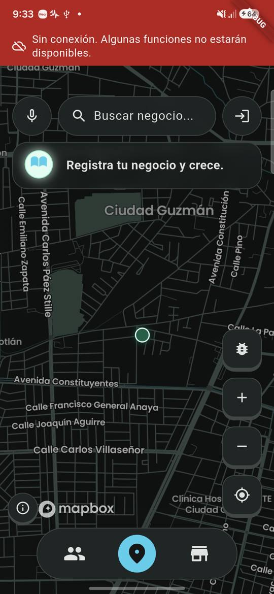 
- **Resultado:** cumple.

### 4. Red perdida durante el uso

- **Esperado:** banner al instante; al reconectar desaparece y los datos se recargan solos.
- **Obtenido:** con la app abierta, apagar solo el Wi-Fi no muestra banner porque el teléfono pasa a datos móviles (comportamiento correcto). Apagando también los datos aparece el banner. Al reactivar ambos, el banner desaparece, aparece `Conexión restablecida` y los marcadores vuelven sin tocar nada.  
- **Observación (O1):** mientras no hay red desaparecen los marcadores de negocios; la app no conserva los últimos datos. No impide el criterio (hay aviso y recuperación) y queda registrado como mejora.
- **Resultado:** cumple.

### 5. Sin ubicación (OUR-133)

Se siguió el checklist de `TESTING.md` con permisos y GPS reales.

- **Permiso revocado:** al abrir, sheet de Nego sin que salga antes el diálogo del sistema; `Continuar sin ubicación` deja el banner `Ournego no puede ver tu ubicación` y el chip `Zona: Ciudad Guzmán`. 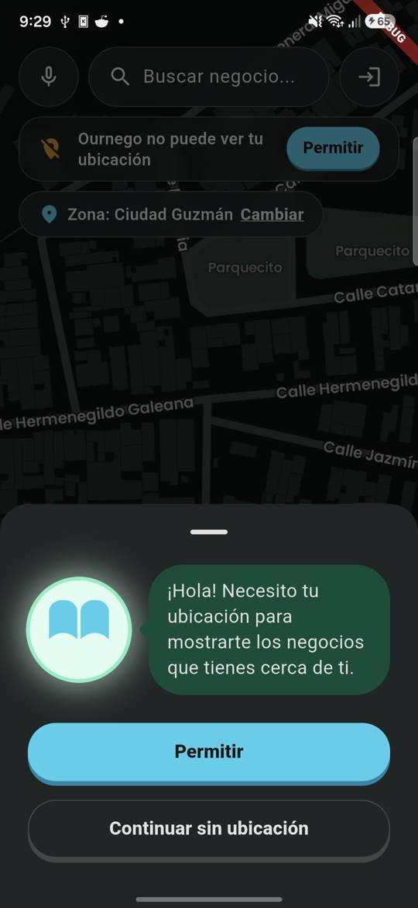
- **Rechazar el diálogo del sistema:** aparece el sheet `Elegir mi zona / Abrir ajustes`; `Elegir mi zona` abre el selector y `Usar el centro del mapa` funciona. 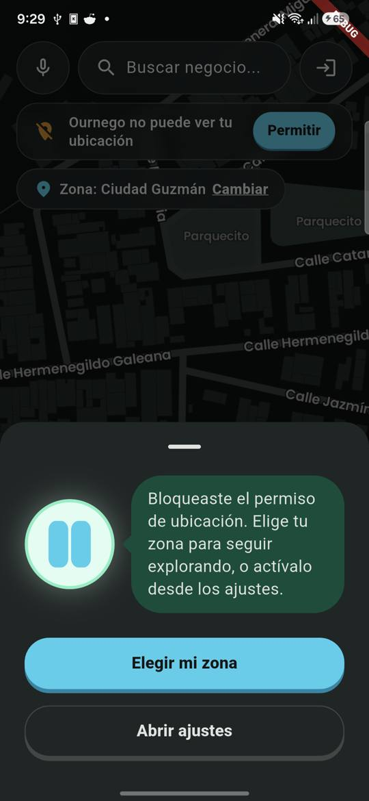
- **Abrir ajustes y conceder:** `Abrir ajustes` abre la pantalla de la app en Ajustes del sistema; el permiso se concedió con `pm grant` (no desde la interfaz de Ajustes) y, al volver a la app, desaparecen el banner y el chip. 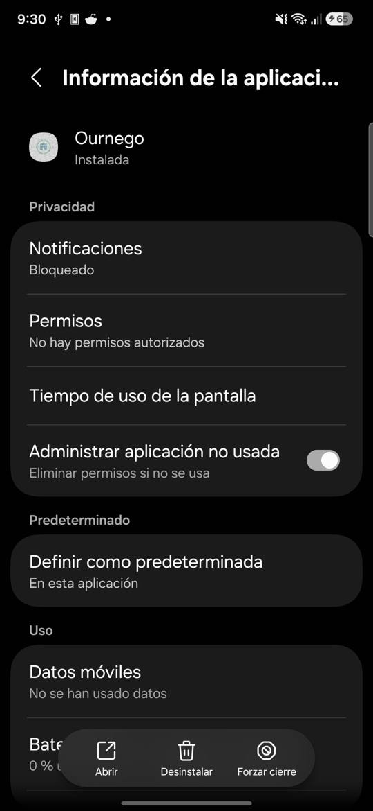
- **GPS apagado con la app abierta:** aparece el diálogo nativo; al rechazarlo queda `Tu GPS está apagado` con `Activar`, el diálogo no se repite al volver a la app y `Activar` + aceptar recupera la posición. 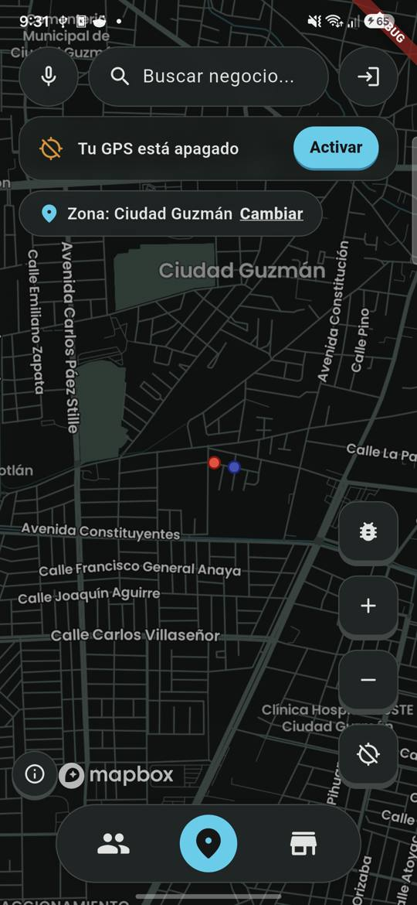 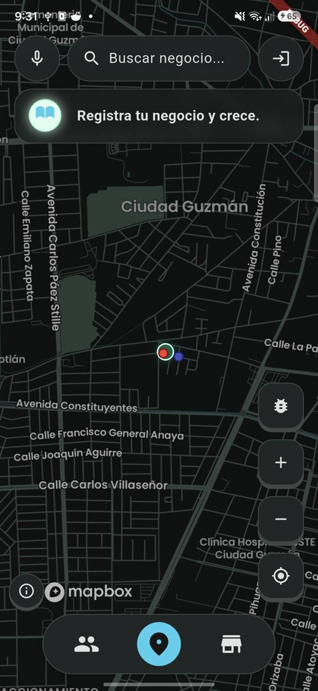
- **Observación (O2):** con el GPS apagado Google Play Services apila dos diálogos propios (`Sin acceso a la ubicación` y `Precisión de la ubicación`). Es comportamiento del sistema, ya conocido de OUR-133.
- **Límite:** solo se revisó en modo oscuro.
- **Resultado:** cumple. En ningún caso hubo pantalla en blanco, carga infinita ni navegación rota.

### 6. Login con Google (OUR-129)

- **Esperado:** mensaje claro con acción de reintento, sin quedar en carga ni en un estado roto.
- **Real:** el selector de cuentas de Google se abre; cerrarlo muestra `Cancelaste el inicio de sesión con Google. Puedes volver a intentarlo.` con `Reintentar`; elegir la cuenta inicia sesión y deja el mapa con avatar (ver 02a). 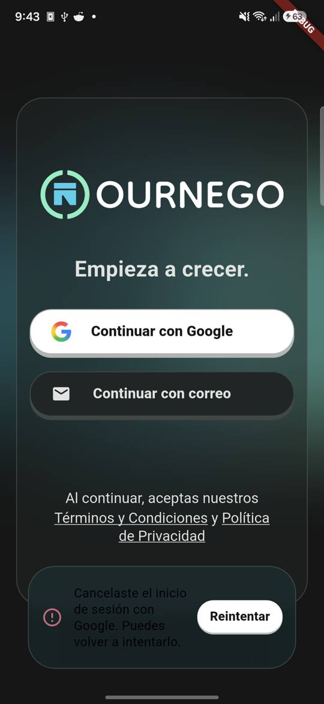
- **Simulado (sección Google del panel):**
  - No disponible: `No pudimos abrir el inicio de sesión de Google en este dispositivo. Inténtalo de nuevo.` 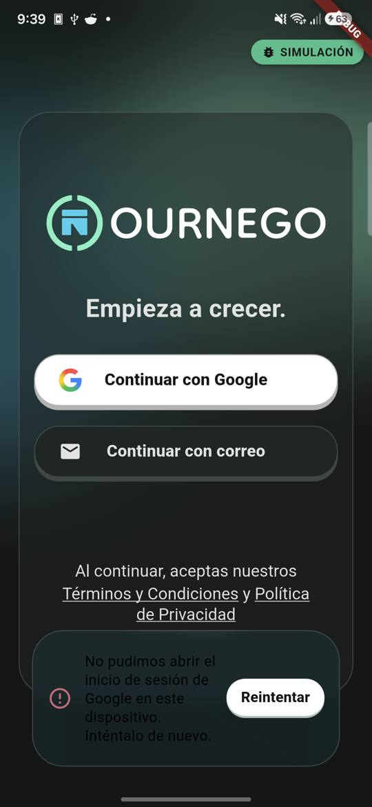
  - Cancelado 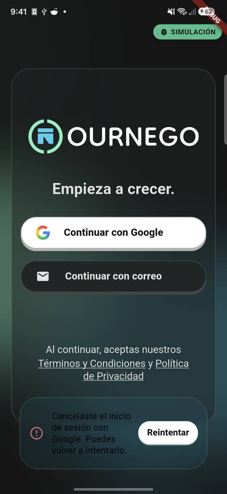
  - Sin red: `Sin conexión. Revisa tu internet e inténtalo de nuevo.` 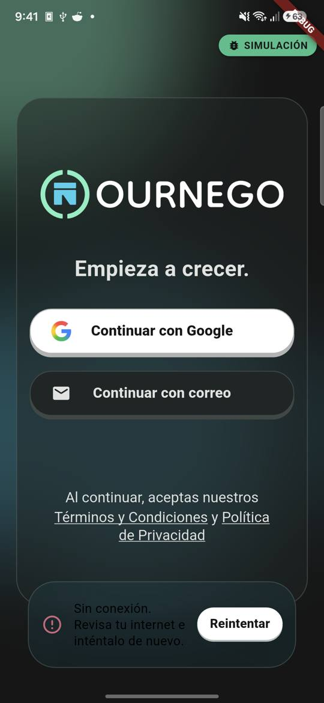
  - Error de servidor: `No pudimos iniciar sesión con Google. Inténtalo de nuevo.` 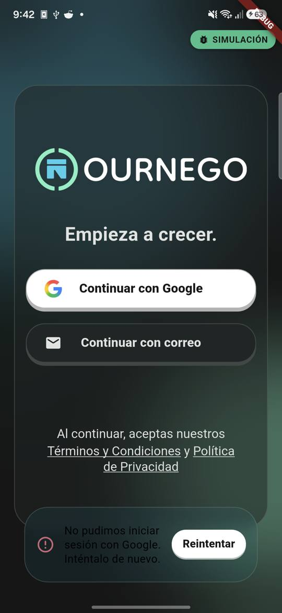
- **Hallazgo (H1):** en modo oscuro el texto del aviso es casi negro sobre fondo oscuro; legible con esfuerzo, de bajo contraste. Ver más abajo.
- **Resultado:** cumple (los mensajes y el reintento funcionan; el contraste es un defecto de presentación).

## Hallazgos

| ID | Hallazgo | Prioridad | ¿Bloquea OUR-110? | Estado |
| --- | --- | --- | --- | --- |
| H1 | Texto de los avisos de error (p. ej. Google) casi negro sobre fondo oscuro en modo oscuro | Media | No: el mensaje y el reintento existen; se deja explícitamente fuera del criterio y se corrige en su propio issue | [OUR-149](https://linear.app/yaheldev/issue/OUR-149) |
| O1 | Los marcadores de negocios desaparecen mientras no hay red | Baja | No | [OUR-150](https://linear.app/yaheldev/issue/OUR-150) |
| O2 | Doble diálogo de Play Services al apagar el GPS | — | No (sistema) | Solo documentado |
| S1 | Simulador: la pestaña de simulación tapaba el botón de perfil y el banner offline | Baja | No | Corregido en la PR #106 (`04aba0f`) |
| S2 | Simulador: las últimas opciones del Debug Panel quedaban tras la barra de navegación | Baja | No | Corregido en la PR #106 (`04aba0f`) |
| S3 | Simulador: la etiqueta del botón de la franja de arranque se truncaba | Baja | No | Corregido en la PR #106 (`04aba0f`) |
| S4 | Simulador: la tarjeta `Señales reales` no se refresca sola al volver al panel | Baja | No | Conocido; usar `Actualizar` |

## Conclusión

Los seis escenarios de la matriz se comportan como se espera en un dispositivo Android físico. No hay fallos que bloqueen OUR-110. Quedan fuera del criterio y registrados: H1 (contraste) y O1 (marcadores sin red). Esta matriz es el punto de partida de OUR-102.

## Cómo repetirlo

```bash
adb devices                                         # un dispositivo físico
flutter run -d <id> --dart-define-from-file=.env
```

Desde el Debug Panel hay presets de un toque para cada escenario. Para condiciones reales, ver la sección **Método**. Desactivar los datos móviles además del Wi-Fi para quedar sin red de verdad.
